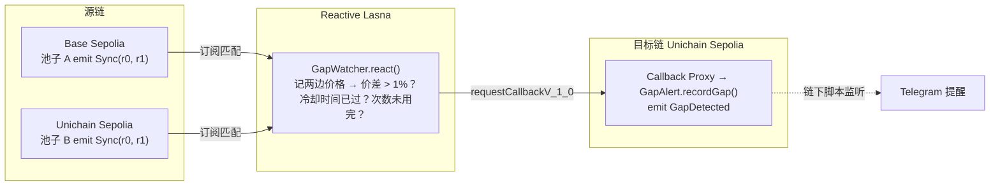

# D1｜用例拆解卡：跨链价差提醒（我自己的想法）

**一句话：** Base Sepolia 和 Unichain Sepolia 上同一交易对的 Uniswap V2 风格池子，价差超过阈值时，自动在目标链记一条价差警报（之后可以扩展成自动再平衡）。

这是我在黑客松想做的方向（赛道 2，个人自动化）的最小版本：先做"发现价差并留痕"，不急着自动交易。

## 四个问题

### 1. 监听哪条链、哪个合约的什么事件？

- 源链 A：Base Sepolia，池子 A 的 `Sync(uint112 reserve0, uint112 reserve1)` 事件
- 源链 B：Unichain Sepolia，池子 B 的同一个事件
- Reactive 合约在构造函数里订阅两条：`chainId + 池子地址 + Sync 的 topic0`
- 每次池子发生交易或流动性变化都会 emit `Sync`，里面带最新储备量，可以直接算价格

### 2. 满足什么条件时触发？

在 `react()` 里：

1. 看 `log.chainId` 判断是哪条链的池子，用 `reserve1 / reserve0` 算出价格，存为这条链的最新价格
2. 两边都有价格后，算价差 `|pA − pB| / min(pA, pB)`
3. 价差 > 阈值（比如 1%），**并且**距上一次警报超过冷却时间（用时间戳，因为 Base Sepolia 是 200ms 出块），才发回调
4. 设总次数上限，到了就停（防止把 lREACT 烧光）

注意：订阅只能做"等于"匹配，"价差大于 X"只能在 `react()` 里判断。

### 3. 在哪条链做什么动作？

- 目标链：Unichain Sepolia（也可以选 Base Sepolia）
- 回调合约 `GapAlert` 的 `recordGap(address rvmSender, uint256 pA, uint256 pB, uint256 gapBps)`：写一条记录并 emit `GapDetected` 事件
- 链下用一个小脚本监听 `GapDetected`，推送到 Telegram
- 进阶版：回调合约用事先授权、额度受限的测试代币，在便宜的一边做一笔小额再平衡

### 4. 不用 Reactive 要怎么做？Reactive 让它简单在哪里，代价是什么？

**不用 Reactive：** 自己写一个 Python 机器人，7×24 小时同时轮询两条链的 RPC（或订阅 websocket），自己算价差，再用服务器上的私钥签名发交易。要租服务器、处理 RPC 断线和漏块、保管私钥，机器人停了也没人知道。

**Reactive 简单在哪里：**
- 不用跑服务器，网络替我监听两条链的事件
- 跨链监听和"在另一条链发交易"是内置的，不用自己管两条链的连接和私钥
- 每一步（源链事件 → react() → 回调）都是链上交易，可以核验

**代价：**
- 每次 `react()` 都收费，回滚也照收。活跃的池子 Sync 很频繁，要先算清楚每天的费用，并设次数上限
- 两边都要存钱：Reactive 合约用 lREACT 付 `react()`，回调合约用目标链的 ETH 付回调；任何一边有欠款都会停
- 从储备量算出来的现货价可以被操纵，不是安全的预言机；只适合做提醒或小额测试
- 两条链上的动作是两笔独立交易，不是原子的；做套利的话一边成功、一边失败要有处理方案
- 有延迟（源链出块 → Reactive 约 1 秒出块 → 目标链出块），和专业套利机器人比没有优势

**顺带的结论：** 我原本还想监控交易所的资金费率。资金费率在 CEX 上，链上没有事件可以订阅，属于开营分享里说的"只依赖链下数据"的弱场景。要做的话得换成链上永续 DEX 发出的资金费率事件，或者先专注链上价差。

## 简图

参考：场景手册「场景 3 止损」「场景 4 跨链价差」；[Reactive Contracts 文档](https://dev.reactive.network/reactive-contracts)
